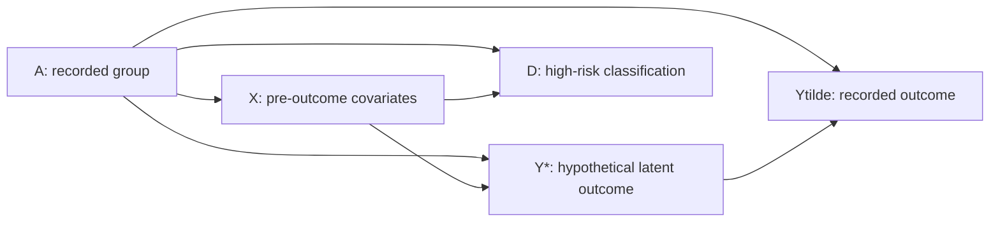

# When Noisy Outcomes Reverse Criminal-Justice Fairness Conclusions

**ICT 5143: Algorithms Fairness and Graphical Models Laboratory · Problem 7 · Team 1**

| Team member | Roll number |
| --- | --- |
| Abner Stan Fernandez | 261090830008 |
| Monis Khursheed | 261090830013 |

A reproducible, retrospective fairness audit of ProPublica's COMPAS two-year recidivism data. This project tests how conclusions change under hypothetical outcome-recording errors. It does not identify actual offenses, establish which classifier is truly fairer, or recommend criminal-justice deployment.

## 1. Task, question and contribution

**Task.** Predict the released binary outcome and compare unmitigated and mitigated classifiers on the same held-out people, then stress-test their fairness ranking under group-specific measurement errors.

- **Dataset:** ProPublica `compas-scores-two-years.csv`; 7,214 released records, 6,172 eligible people after the notebook restrictions. See the [data card](#data-card).
- **`Y=1`:** the observed `two_year_recid=1` label, meaning recorded two-year recidivism in the release. We write this observed label as `Ytilde` (or Ỹ) below to distinguish it from the hypothetical latent outcome `Ystar` (Y*). Recorded recidivism/rearrest is an imperfect proxy for behavior.
- **`D=1`:** a positive high-risk classification, not an actual detention or sentencing decision. For released COMPAS scores this means decile ≥5; learned models use validation-selected thresholds. For EO post-processing, the underlying decision is binary and primary estimates integrate its randomization analytically.

**Falsifiable question.** Within the primary feasible recording-error region, can the equalized-odds ranking of unmitigated LR versus group-specific EO post-processing reverse relative to its observed-label ranking? The hypothesis is refuted within that tested region if no strict reversal occurs. A strict reversal requires opposite disparity-difference signs, each exceeding `1e-4` in magnitude.

**Closest reproduction.** We reproduce the cohort and adjusted high-score logistic regression from the [ProPublica analysis notebook](https://github.com/propublica/compas-analysis), including the African-American/Caucasian coefficient **0.47720698** versus the notebook's **0.47721**. We also audit released-score confusion rates. This is a scoped reproduction of the notebook audit; the separate survival/Cox truth-table analysis was not rerun. [Cohort reproduction details](docs/COHORT_REPORT.md).

**Contribution.** A group-specific measurement model and feasibility-checked inversion connect recorded decision–outcome cells to hypothetical latent cells. Common feasible scenarios support paired method comparisons, ranking reversals, zero-noise checks and synthetic validation. The original study saves 75 sensitivity tables with 154,395 comparisons, 270 synthetic datasets and 1,000 paired evaluation bootstraps. Additional validation includes independent eight-parameter intersection designs and 6,000 positive, negative and boundary control datasets.

**Scope limits.** Error rates and Y* are not identified from COMPAS. The grids are exploratory stress tests, not estimated priors; original pre-analysis timing is not independently verifiable. The original intersection grid shares errors across sexes within race; the later Sobol designs vary all eight parameters independently but cover only finitely many points. Sparse groups, inherited follow-up decisions, fixed-model uncertainty and absent external replication limit conclusions. See [assumptions](docs/ASSUMPTIONS.md) and the [full report](docs/FINAL_REPORT.md).

## 2. Model, inference and fairness

### Measurement graph



The corresponding [measurement figure](figures/01_measurement_dag.png) and [implementation](compas_fairness/measurement.py) describe a statistical generative model.

```math
p(a,x,y^*,d,\tilde y)
=p(a)\,p(x\mid a)\,p(y^*\mid a,x)\,p(d\mid a,x)\,p(\tilde y\mid y^*,a).
```

**Observed:** group `A` (race, sex or intersection), covariates `X`, recorded outcome Ỹ and evaluated decision `D`. The six predictors are age, prior count, three juvenile-history counts and current charge degree. **Latent:** Y*. Group recording rates are fixed sensitivity inputs:

```math
\alpha_a=P(\tilde Y=1\mid Y^*=0,A=a),\qquad
\beta_a=P(\tilde Y=0\mid Y^*=1,A=a).
```

The key assumption is Ỹ ⟂ (`X`,`D`) | (`Y*`,`A`). For each decision stratum, the measurement equation is

```math
\begin{bmatrix}P(D=d,\tilde Y=0\mid a)\\P(D=d,\tilde Y=1\mid a)\end{bmatrix}
=
\begin{bmatrix}1-\alpha_a&\beta_a\\\alpha_a&1-\beta_a\end{bmatrix}
\begin{bmatrix}P(D=d,Y^*=0\mid a)\\P(D=d,Y^*=1\mid a)\end{bmatrix}.
```

**Inference query:** `P(Y*=1 | D=d, A=a; alpha_a, beta_a)`, obtained by inverting these joint cells and normalizing within `D=d`. Inversion requires `1-alpha-beta > 1e-8`, valid cells and forward reconstruction within `1e-10`; undefined outcome denominators invalidate fairness metrics. Materially negative cells are rejected, not clipped. Feasibility shows compatibility, not that the independence assumption is true. A separate illustrative Bayesian network checks `P(Y* | A, Ytilde, D)` by pgmpy variable elimination against direct enumeration; it does not fit an identified latent-outcome model to COMPAS.

**Predictive models.** LR, histogram gradient-boosted trees, a discretized Laplace-smoothed naive Bayesian network, and released COMPAS scores. The predictive BN uses `p(Ytilde) ∏j p(Xj | Ytilde)` and treats the recorded label as error-free; it is distinct from the measurement graph. Reweighing uses training group/label frequencies; Fairlearn EO post-processing fits group-specific randomized thresholds on validation data. Base predictors exclude race and sex; auditing and mitigation use them separately, and EO requires group membership at decision time. [Model card](#model-card).

**Primary fairness criterion:** equalized-odds disparity

```math
\Delta_{EO}=\max\{\max_a TPR_a-\min_a TPR_a,\ \max_a FPR_a-\min_a FPR_a\},
```

where `TPR_a=P(D=1 | Y=1,A=a)` and `FPR_a=P(D=1 | Y=0,A=a)`, using Ỹ for observed evaluation and Y* for hypothetical evaluation. Lower is better. The normative rationale is to examine both unequal false high-risk classifications and unequal detection conditional on outcome status. This choice does not resolve whether the recorded label is legitimate or whether classification should be used. Calibration, predictive parity and selection rates can raise different concerns; EO alone does not establish fairness. No acceptable utility-loss threshold was prespecified.

## 3. Headline results

Held-out test set: **1,235 people**. Every interval below uses **1,000 paired person-level bootstrap resamples**, with identical resampled people across methods and fixed fitted models. Brackets are percentile 95% intervals; paired changes are **EO-sex minus LR**, not differences between marginal interval endpoints.

| Measure | LR baseline | EO-sex policy | Paired change [95% interval] |
| --- | --- | --- | --- |
| Observed sex EO gap ↓ | 0.1740 [0.0865, 0.2884] | 0.0291 [0.0128, 0.1323] | −0.1449 [−0.2284, 0.0051] |
| Balanced accuracy ↑ | 0.6550 [0.6278, 0.6819] | 0.6521 [0.6283, 0.6779] | −0.0029 [−0.0111, 0.0064] |
| AUROC ↑ | 0.7187 [0.6908, 0.7467] | 0.7187 [0.6908, 0.7467] | 0.0000 [0.0000, 0.0000] |
| Log loss ↓ | 0.6128 [0.5916, 0.6323] | 0.6128 [0.5916, 0.6323] | 0.0000 [0.0000, 0.0000] |
| Brier score ↓ | 0.2120 [0.2030, 0.2207] | 0.2120 [0.2030, 0.2207] | 0.0000 [0.0000, 0.0000] |

EO changes the decision policy, while AUROC/log loss/Brier evaluate its **unchanged underlying LR risk score**. They do not assess selection probabilities as risk predictions. The observed EO reduction accompanies a 0.29 percentage-point balanced-accuracy loss. Both paired change intervals include zero: this sample does not establish a population fairness advantage or utility loss. Intervals omit training, model-selection and measurement-assumption uncertainty; comparisons are exploratory and unadjusted for multiplicity.

**Sensitivity finding.** With each group's `(alpha,beta)` in `{0,0.025,...,0.20}`, sex LR versus EO-sex reverses in **2,068/6,561 feasible scenarios (31.52%)**. For Female `(0.175,0.10)` and Male `(0.15,0)`, the hypothetical EO gaps become LR **0.1161** versus EO-sex **0.1537**, reversing the observed ranking. These are conditional calculations; 31.52% is a fraction of the specified grid, not the probability of a real-world reversal. Sensitivity ranges are not confidence intervals.

**Group support** (test set, shared across methods):

| Recorded group | Total | Ỹ=0 (FPR denominator) | Ỹ=1 (TPR denominator) |
| --- | --- | --- | --- |
| Female | 235 | 153 | 82 |
| Male | 1,000 | 521 | 479 |
| African-American | 665 | 327 | 338 |
| Caucasian | 422 | 249 | 173 |

The sex comparison uses all 1,235 test people; primary Black/white and four supported Black/white-by-sex intersection comparisons use 1,087, excluding 148 other-race people from those contrasts. All released groups remain in descriptive tables. Intersection sensitivity requires ≥20 people in each observed outcome class. EO fitting falls back to LR for validation groups with <5 in either class; sparse results do not support broad conclusions.

**Failure cases.** LR versus EO-race has **0/6,561** primary-grid reversals, so reversal is not universal. More seriously, when recording errors depend on covariates within group and latent class, the additional simulation at `N=10,000` gives method-0 sampling-interval coverage **0.735 [0.6698, 0.7913]** (95% Wilson Monte Carlo interval, 200 datasets), well below nominal 95%. Compatibility alone cannot protect against a wrong measurement assumption.

Full evidence: [report](docs/FINAL_REPORT.md), [predictive estimates](results/predictive.csv), [predictive intervals](results/predictive_intervals.csv), [paired utility differences](results/predictive_difference_intervals.csv), [paired fairness intervals](results/bootstrap_intervals.csv), [group metrics](results/group_metrics.csv), [calibration bins](results/calibration.csv), [sensitivity summary](results/sensitivity_summary.csv), [scenario tables](results/sensitivity/), [representative inversions](results/representative_scenarios.json), [Monte Carlo intervals](results/verification/monte_carlo_intervals.csv) and [additional intersection/control results](results/completion/).

## 4. Installation and data

**Prerequisites:** Git, CPython **3.12.14**, `venv`/pip, a CPU and HTTPS access for source/dependency downloads. The retained environment is **Linux x86_64**, with `OMP_NUM_THREADS=2` and `OPENBLAS_NUM_THREADS=2`; no GPU, service or database is needed. Python ≥3.11 was intended, but the exact environment was validated on 3.12/Linux only. macOS/Windows compatibility has not been established. [Environment specification](ENVIRONMENT_SPEC.json) and [fully pinned dependency versions](requirements.txt) are authoritative; core pins include NumPy 2.5.4, pandas 3.1.1, scikit-learn 1.9.1, Fairlearn 0.15.0 and pgmpy 1.1.2.

From a clean clone:

```bash
git clone https://github.com/RookieCoders/afgml-compas-criminal-dataset.git
cd afgml-compas-criminal-dataset
python3.12 -m venv .venv
. .venv/bin/activate
python -m pip install -r requirements.txt
export OMP_NUM_THREADS=2
export OPENBLAS_NUM_THREADS=2
export MPLBACKEND=Agg
python scripts/fetch_data.py
```

The fetch script acquires the public CSV and analysis sources from immutable ProPublica commit `bafff5da3f2e45eca6c2d5055faad269defd135a`, verifies SHA256 values in [the provenance manifest](data/raw/provenance.json), and refuses to overwrite changed raw files. The CSV is excluded from Git; it must be fetched after cloning. No manual relabeling or external download portal is required. The experiment CLI prepares the cohort and split automatically: screening offset within ±30 days, `is_recid != -1`, charge degree not `O`, valid score category, then person-identity checks/deduplication. Expected split: **3,703 train / 1,234 validation / 1,235 test**, sex/outcome stratified, seed 2026. [Preparation code](compas_fairness/data.py), [dictionary](docs/DATA_DICTIONARY.csv) and [provenance](docs/PROVENANCE.md).

**Access and permissions:** no dataset API key or account is required for the public upstream source. If this project repository is access-restricted, obtain GitHub repository access and authenticate yourself. Users must obtain any institutional data-use/ethics approval applicable to their own use, plus any organizational proxy/network access. No credentials or approvals are supplied by this project. Public availability does not constitute a new license or permission for every downstream use; upstream attribution and terms apply. Keep identifying raw records local. Offline analysis works once dependencies and checksum-verified sources are available.

## 5. Reproduction and executable demonstration

### One headline table

After the clean-clone installation above, run the actual full-resolution models and sensitivity stages:

```bash
python -m compas_fairness.run --config configs/full.json --stages models,sensitivity
python - <<'PY'
import csv
from pathlib import Path
rows = csv.DictReader(Path('results/sensitivity_summary.csv').open())
row = next(r for r in rows if r['axis'] == 'sex' and r['region'] == 'primary'
           and r['left'] == 'LR' and r['right'] == 'EO_sex')
columns = ['axis', 'left', 'right', 'feasible', 'reversed', 'reversal_fraction']
print(','.join(columns))
print(','.join(row[c] for c in columns))
PY
```

Expected headline row: `sex,LR,EO_sex,6561,2068,0.315196...`. This trains the models and regenerates [the sensitivity table](results/sensitivity_summary.csv), compressed scenario tables and [test predictions](results/test_predictions.csv.gz). It does not regenerate confidence intervals; run the full workflow below for those. Existing released results allow immediate inspection, but inspection alone is not a fresh experiment.

### Full experiments and figures

Run in a disposable clone if you want to preserve the released artifacts: the CLI writes to `results/`, `figures/` and the report in place.

```bash
# Original experiments: audit, models, sensitivity, simulation, bootstrap,
# robustness, report and the 14 original figure sets.
python -m compas_fairness.run --config configs/full.json

# Separate 200-repetition/configuration simulation validation and MC figure.
python -m scripts.run_verification_simulation
python -m scripts.verification_precision

# Independent intersection parameters and 6,000 reversal-control datasets.
python -m compas_fairness.completion
python -m scripts.completion_report

# Tests and consistency checks.
python -m pytest -q
python scripts/check_results.py
python -m scripts.check_completion
```

Expected outputs include the headline table above, [bootstrap intervals](results/bootstrap_intervals.csv), [simulation summaries](results/simulation_summary.csv), [additional simulation results](results/verification_simulation/), [completion summaries](results/completion/), [14 original figure sets and captions](figures/CAPTIONS.md), [two completion figure sets](figures/completion/) and the regenerated [report](docs/FINAL_REPORT.md). The original simulation has 270 datasets; the separate validation has 1,800 datasets; completion has 6,000 control datasets. Method-level rows must not be counted as distinct datasets. The retained completion test record reports 40 passing tests; that is historical execution evidence, not a claim that this README edit reran them.

**Resource planning:** budget roughly **1–5 minutes** for the headline stages, **5–20 minutes** for the original full workflow and **10–60 minutes** for all additional validation, excluding installation/downloads. Use two CPU threads and provision approximately **4–8 GiB RAM**. These are planning estimates, not measured guarantees: retained logs show stage completions over minutes, but do not record a complete fresh-run benchmark, CPU model or peak RAM. No GPU is required. Hardware and package availability can change runtime substantially.

For a quick pipeline check, `python -m compas_fairness.run --config configs/smoke.json` uses reduced bootstraps, simulation repetitions and grids; it cannot reproduce the headline counts and also overwrites artifacts. Use a separate clone. For selected stages, the CLI accepts `--stages audit,models,sensitivity,simulation,bootstrap,robustness,report`. `--reuse-models` accepts only a locally trusted, content-verified model cache; after code/dependency changes retrain without it. Clean clones train their own cache. New stage executions append configuration and source fingerprints to [stage history](results/stage_history.jsonl).


## 6. Related work

| Source | Role in this project | Reproduction boundary / extension |
| --- | --- | --- |
| [ProPublica COMPAS data and notebook (2016)](https://github.com/propublica/compas-analysis) | Closest empirical audit reproduced | Notebook cohort, adjusted score association and released-score confusion audit; no separate Cox reproduction. Adds hypothetical recording-error sensitivity. |
| [Chouldechova (2017), Fair Prediction with Disparate Impact](https://doi.org/10.1089/big.2016.0047) | Context for competing fairness criteria in recidivism prediction | Interpretive reference; its experiments/theorems are not claimed as reproduced here. |
| [Hardt, Price and Srebro (2016), Equality of Opportunity in Supervised Learning](https://proceedings.neurips.cc/paper_files/paper/2016/hash/6a9659feb1216f14f7384ba499518b38-Abstract.html) | Basis for group-aware equalized-odds post-processing | Implemented through Fairlearn on validation data; evaluates sensitivity of the resulting policy rather than claiming its real-world fairness. |
| [Kamiran and Calders (2012), Data preprocessing techniques for classification without discrimination](https://link.springer.com/article/10.1007/s10115-011-0463-8) | Training-data reweighing baseline | Uses observed group/label frequencies; does not estimate recording errors. |

## 7. Cards and evidence index

### Data card

- **Origin/population:** ProPublica's public Broward County COMPAS release; historical observational records, not a representative sample of all defendants or jurisdictions. [Source hashes and provenance](docs/PROVENANCE.md).
- **Target and support:** observed `two_year_recid`, not latent offense incidence; 6,172 eligible people, person-disjoint split and group support above. [Cohort flow](results/cohort_flow.csv), [quality/missingness](results/data_quality.json), [dictionary](docs/DATA_DICTIONARY.csv).
- **Sensitive information:** recorded race/sex and identifying raw records. Hashed identity supports duplicate/split checks and is not anonymization. Historical covariates can encode enforcement patterns. Follow-up/censoring decisions are inherited from the source.
- **Use limits:** retrospective research and sensitivity analysis; no deployment validation. Primary Black/white contrasts exclude other races; sparse groups remain descriptive. [Full cohort report](docs/COHORT_REPORT.md).

### Model card

- **Purpose:** compare recorded-label prediction and fairness sensitivity; not a validated tool for detention, sentencing or policing.
- **Training/evaluation:** training-only preprocessing and reweighing; validation-only hyperparameter/threshold selection; one frozen test split. LR/GBT exclude race/sex; EO uses the selected group at decision time. [Models](compas_fairness/models.py), [selection results](results/model_selection.csv), [decision rules and fallbacks](results/decision_rules.json).
- **Outputs:** risk scores, deterministic or randomized high-risk decisions, expected confusion cells, group metrics and conditional sensitivity estimates. Probability quality concerns the risk score; randomized policy probabilities are separate.
- **Limits:** unidentified latent outcomes/errors, sparse-group fallbacks, calibration/EO tensions, fixed-fit bootstrap uncertainty and possible independence violations. No single metric establishes substantive fairness. [Assumption register](docs/ASSUMPTIONS.md).

| Evidence | Location and status |
| --- | --- |
| Experimental configuration and assumptions | [Original full config](configs/full.json), [assumption register](docs/ASSUMPTIONS.md); exploratory, no verifiable external preregistration |
| Verification and added-analysis protocols | [Verification protocol](docs/VERIFICATION_PROTOCOL.json), [completion protocol](docs/COMPLETION_PROTOCOL.json) |
| Requirement matrix and clause traceability | [Requirements matrix](docs/REQUIREMENTS_MATRIX.md), [traceability CSV](docs/ORIGINAL_REQUIREMENTS_TRACEABILITY.csv), [original specification](docs/ORIGINAL_SPECIFICATION.md) |
| Related-work table | [Table above](#6-related-work) |
| Dataset and model cards | [Data card](#data-card), [model card](#model-card) |
| Full report | [Final report, including verification and completion findings](docs/FINAL_REPORT.md) |
| Slides | [AFGML capstone presentation (PDF)](docs/AFGML_Capstone.pdf) |
| Demonstration | [Executable demonstration and empty recording-link template](#5-reproduction-and-executable-demonstration); recording URL not yet supplied |
| Execution/validation records | [Project status](PROJECT_STATUS.md), [run manifest](results/run_manifest.json), [original tests](results/tests.xml), [completion tests](results/completion/tests.xml), [artifact validation](results/artifact_validation.json), [completion validation](results/completion/validation.json), [verification notes](docs/VERIFICATION_NOTES.md) |

Historical logs, matrices and slides describe their retained runs; they are not evidence of a new independent replication. Some historical status statements predate later completion work; use the final report and current requirement matrix for the reconciled assessment.
